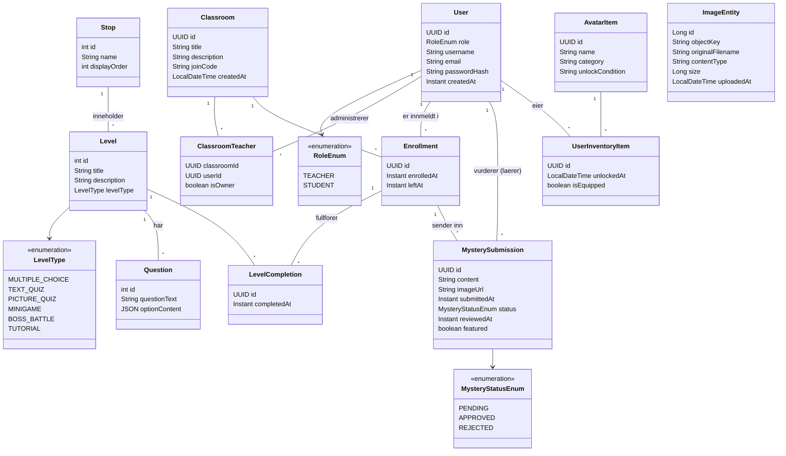

# Domenemodell

## Oversikt

Domenemodellen viser de sentrale entitetene i Nettdetektivene og relasjonene mellom dem. Systemet er bygget rundt tre hovedomraader: **brukere og klasserom**, **spillogikk** og **avatar/gamification**.

## Domenediagram (Mermaid)

## Beskrivelse av entiteter

### Brukere og klasserom

| Entitet | Beskrivelse |
|---------|-------------|
| **User** | Representerer baade elever og laerere. Rollen bestemmes av `RoleEnum`. |
| **Classroom** | Et klasserom opprettet av en laerer, med unik `joinCode` som elever bruker for aa bli med. |
| **ClassroomTeacher** | Kobling mellom laerer og klasserom. `isOwner` markerer hvem som opprettet rommet. Flere laerere kan administrere samme rom. |
| **Enrollment** | Kobling mellom elev og klasserom. `leftAt` settes naar en elev forlater rommet. |

### Spillogikk

| Entitet | Beskrivelse |
|---------|-------------|
| **Stop** | Et stoppested paa kartet (f.eks. Nyhetskvartalet, Fotografen, Postkontoret). `displayOrder` styrer rekkefølgen. |
| **Level** | En oppgave innenfor et stoppested. Hvert stoppested har 3 nivåer med oekende vanskelighetsgrad. `LevelType` bestemmer oppgavetypen. |
| **Question** | Et spoersmaal innenfor et nivaa. `optionContent` lagres som JSON med svaralternativer (MultipleChoiceOption). |
| **LevelCompletion** | Registrerer naar en elev (via enrollment) fullforer et nivaa. Unik kombinasjon av enrollment + level. |

### Ukens mysterium

| Entitet | Beskrivelse |
|---------|-------------|
| **MysterySubmission** | En elevs innsending til ukens mysterium. Kan inneholde tekst og bilde. Status gaar fra PENDING til APPROVED/REJECTED etter laerevurdering. `featured` markerer om den vises som ukens mysterium. |

### Avatar og gamification

| Entitet | Beskrivelse |
|---------|-------------|
| **AvatarItem** | Et tilgjengelig avatar-element (haarsil, klær, tilbehoer osv.) med kategori og opplaasningsbetingelse. |
| **UserInventoryItem** | Kobling mellom bruker og opplaaste avatar-elementer. `isEquipped` viser om elementet er paa. |

### Media

| Entitet | Beskrivelse |
|---------|-------------|
| **ImageEntity** | Metadata for bilder lagret i S3. Brukes av oppgaver og mystery submissions. |
